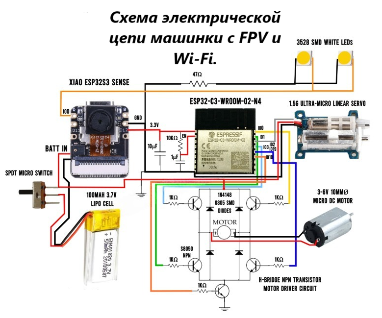
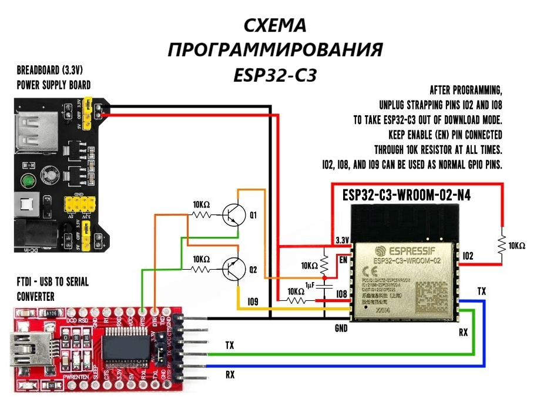
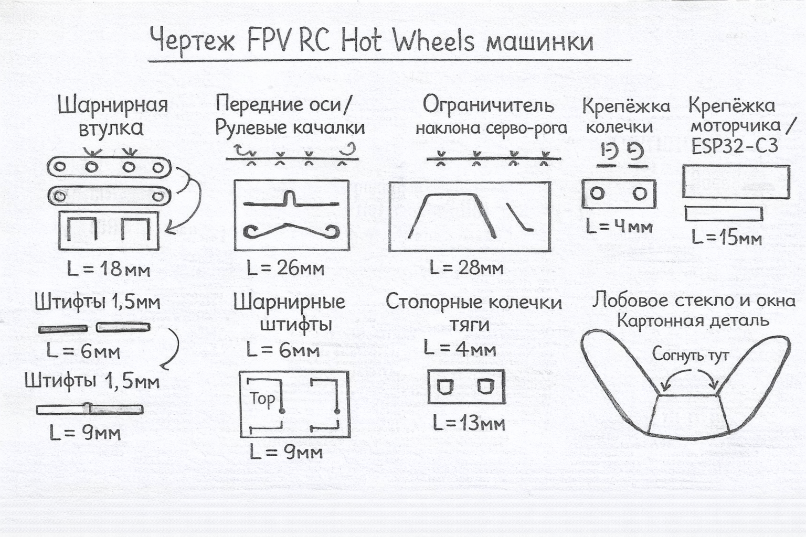

# FPV RC Car

Проект FPV радиоуправляемой машинки на базе ESP32 с возможностью видеотрансляции и удаленного управления через веб-интерфейс.

## 📋 Описание

Проект состоит из двух основных компонентов:

- **ESP32 WiFi Car** — система управления машинкой через WebSocket с веб-интерфейсом
- **ESP32-CAM MJPEG2SD** — система видеозаписи и стриминга с камеры в реальном времени

Машинка управляется через браузер с любого устройства (смартфон, планшет, компьютер) в локальной сети WiFi. Видеопоток с камеры транслируется в реальном времени, что обеспечивает полноценный FPV опыт.

## ✨ Особенности

### ESP32 WiFi Car
- 🎮 Управление через веб-интерфейс с любого устройства
- ⚡ WebSocket для низкой задержки управления
- 🚗 Два мотора с PWM-управлением скоростью
- 🎯 Серво-руль для управления направлением
- 📱 Адаптивный веб-интерфейс с сенсорным управлением

### ESP32-CAM MJPEG2SD
- 📹 Видеотрансляция в реальном времени (MJPEG stream)
- 💾 Запись видео на SD-карту в формате AVI
- 🎥 Поддержка различных разрешений камеры (от 96x96 до UXGA)
- 🔍 Детекция движения с автоматической записью
- 🌐 Веб-сервер для просмотра видео и управления
- 📊 Телеметрия (опционально)
- 🎤 Аудиозапись (опционально)

## 🚀 Быстрый старт

### Требования

- ESP32 Dev Module (для управления машинкой)
- ESP32-CAM модуль с OV2640 камерой (для видеотрансляции)
- 2x H-мост драйвер для моторов (например, MX1508)
- 2x DC моторы
- 1x сервопривод SG90 для руля
- SD-карта (для записи видео)
- Источник питания (рекомендуется LiPo батарея)

### Установка

#### 1. Установка Arduino IDE

1. Установите [Arduino IDE](https://www.arduino.cc/en/software)
2. Добавьте поддержку ESP32 через меню: **Файл → Настройки → Дополнительные ссылки для менеджера плат**
3. Добавьте URL: `https://raw.githubusercontent.com/espressif/arduino-esp32/gh-pages/package_esp32_index.json`
4. Установите платформу ESP32 через **Инструменты → Плата → Менеджер плат**

#### 2. Установка библиотек

Для **ESP32 WiFi Car**:
- `WebSockets` (Markus Sattler)
- `ESP32Servo` (Kevin Harrington)

Для **ESP32-CAM MJPEG2SD**:
- Все необходимые библиотеки включены в проект

#### 3. Настройка ESP32 WiFi Car

1. Откройте `ESP32_web_socket_car/ESP32_wifi_car/ESP32_wifi_car.ino`
2. В файле `ESP32_wifi_car.ino` измените настройки WiFi:
   ```cpp
   const char* ssid = "ВАШ_SSID";
   const char* password = "ВАШ_ПАРОЛЬ";
   ```
3. Загрузите файлы из папки `data` в SPIFFS:
   - Используйте плагин [ESP32 Sketch Data Upload](https://github.com/me-no-dev/arduino-esp32fs-plugin)
   - Или через PlatformIO
4. Загрузите скетч на ESP32
5. Откройте Serial Monitor (115200 baud) для получения IP-адреса

#### 4. Настройка ESP32-CAM MJPEG2SD

1. Откройте `ESP32-CAM_MJPEG2SD/ESP32-CAM_MJPEG2SD.ino`
2. В файле `appGlobals.h` выберите модель вашей камеры:
   ```cpp
   #define CAMERA_MODEL_AI_THINKER  // для ESP32-CAM AI-Thinker
   // или
   #define CAMERA_MODEL_ESP32_S3_CAM  // для ESP32-S3-CAM
   ```
3. Настройте опциональные функции в `appGlobals.h` (по умолчанию все отключены)
4. Выберите плату: **Инструменты → Плата → ESP32 Dev Module** (или ESP32S3 Dev Module)
5. Включите PSRAM: **Инструменты → PSRAM → OPI PSRAM**
6. Выберите схему разделения: **Инструменты → Partition Scheme → Minimal SPIFFS** (для ESP32) или **8M with spiffs** (для ESP32S3)
7. Загрузите скетч на ESP32-CAM
8. При первом запуске устройство создаст WiFi точку доступа: `ESP-CAM_MJPEG_...`
9. Подключитесь к точке доступа и откройте `192.168.4.1` в браузере
10. Настройте подключение к вашей WiFi сети

### Сборка машинки

Проект основан на переделке игрушечной машинки Hot Wheels в полноценный FPV RC автомобиль. Основные этапы сборки:

1. **Подготовка корпуса**: удалите штатный привод, прорежьте окна под проводку и стойки для плат; при необходимости вклейте печатные кронштейны под сервопривод и моторы.
2. **Установка моторов**: закрепите два DC мотора на заднюю ось через мини-H-мост (MX1508 или аналог); проверьте свободный ход и соосность.
3. **Установка сервопривода**: установите SG90 на переднюю ось, зафиксируйте тяги руля, ограничьте ход серво механическим упором (см. блюпринт для тяг/серво-рычага).
4. **Платы управления**:
   - ESP32 Dev Module — управление моторами и рулём (WebSocket, порт 81; HTTP, порт 80).
   - ESP32-CAM / ESP32-C3 с камерой — видеотрансляция и запись (MJPEG, AVI на SD).
   Расположите платы так, чтобы камера смотрела вперёд, а антенна Wi‑Fi была приподнята над металлом.
5. **Питание**: установите LiPo, при необходимости добавьте понижающий/повышающий преобразователь на 5 В для серво и 3.3 В для ESP32-C3/CAM; следите за током моторов (пиковые до 1–1.5 А на мотор).
6. **Соединения**: подключите по схемам ниже — сперва питание и землю, затем сигналы моторов и серво, после этого камеру/SD и WebSocket-интерфейс.
7. **Финальная сборка**: уложите проводку, добавьте лёгкий картонный «козырёк» лобового стекла и окна (см. блюпринт), закройте кузов. После сборки проверьте центр руля и направление моторов.

### Подключение оборудования

#### Схема подключения ESP32 WiFi Car



```
ESP32          H-мост (Motor 1)    Мотор 1
GPIO 14 ──────> EN
GPIO 27 ──────> IN1
GPIO 26 ──────> IN2

ESP32          H-мост (Motor 2)    Мотор 2
GPIO 32 ──────> EN
GPIO 33 ──────> IN1
GPIO 25 ──────> IN2

ESP32          Серво
GPIO 18 ──────> Signal
5V     ──────> VCC
GND    ──────> GND
```

#### Схема подключения ESP32-CAM



ESP32-CAM (или ESP32-C3 с камерой) подключается стандартным образом согласно выбранной модели платы. Для записи видео требуется SD-карта. После прошивки снимите перемычки IO2/IO8, оставьте EN через 10kΩ и подключите TX/RX согласно FTDI.

#### Выкрики деталей



## 📁 Структура проекта

```
Hot Wheels FPV RC/
├── README.md                          # Этот файл
├── ESP32_web_socket_car/              # Система управления машинкой
│   └── ESP32_wifi_car/
│       ├── ESP32_wifi_car.ino         # Основной скетч управления
│       └── data/                      # Веб-интерфейс
│           ├── car.html               # HTML страница управления
│           ├── main.js                # JavaScript для WebSocket
│           └── style.css              # Стили интерфейса
├── ESP32-CAM_MJPEG2SD/                # Система видеозаписи
│   ├── ESP32-CAM_MJPEG2SD.ino         # Главный файл приложения
│   ├── appGlobals.h                   # Конфигурация и настройки
│   ├── globals.h                      # Глобальные определения
│   ├── camera_pins.h                  # Определения пинов камеры
│   ├── webServer.cpp                  # Веб-сервер
│   ├── mjpeg2sd.cpp                   # Запись MJPEG на SD
│   ├── streamServer.cpp               # Сервер стриминга
│   ├── motionDetect.cpp               # Детекция движения
│   ├── peripherals.cpp                # Управление периферией
│   ├── mcpwm.cpp                      # Управление моторами (PWM)
│   ├── audio.cpp                      # Аудио функции
│   ├── telemetry.cpp                  # Телеметрия
│   ├── telegram.cpp                   # Интеграция с Telegram
│   ├── mqtt.cpp                       # MQTT поддержка
│   ├── rtsp.cpp                       # RTSP стриминг
│   ├── webDav.cpp                     # WebDAV сервер
│   ├── utils.cpp                      # Утилиты
│   ├── utilsFS.cpp                    # Файловая система
│   ├── prefs.cpp                      # Настройки
│   └── data/                          # Веб-интерфейс камеры
│       ├── MJPEG2SD.htm               # Главная страница
│       ├── common.js                  # Общие JS функции
│       └── Auxil.htm                  # Страница для вспомогательной платы
└── Circuit Diagram - FPV WiFi RC Hot Wheels Car by Max Imagination.jpg
```

## 🛠 Использование

### Управление машинкой

1. Убедитесь, что ESP32 подключен к WiFi сети
2. Откройте Serial Monitor для получения IP-адреса ESP32
3. В браузере откройте `http://IP_АДРЕС_ESP32`
4. Используйте вертикальный слайдер для управления вперед/назад
5. Используйте горизонтальный слайдер для управления рулем (влево/вправо)

### Видеотрансляция и запись

1. После настройки ESP32-CAM откройте веб-интерфейс по IP-адресу камеры
2. Нажмите **Start Stream** для просмотра видео в реальном времени
3. Нажмите **Start Recording** для начала записи видео
4. Записанные файлы сохраняются на SD-карту в формате AVI
5. Для воспроизведения записей используйте раздел **Playback & File Transfers**

### Настройка детекции движения

1. В веб-интерфейсе камеры перейдите в **Motion Detect & Recording**
2. Включите **Enable motion detect**
3. Настройте **Motion Sensitivity** (чувствительность)
4. При обнаружении движения автоматически начнется запись

### Удаленное управление (FPV режим)

Для полноценного FPV опыта:
1. Установите ESP32-CAM на машинку
2. Подключите ESP32-CAM к той же WiFi сети, что и ESP32 управления
3. Откройте веб-интерфейс камеры на одном устройстве (для видео)
4. Откройте веб-интерфейс управления на другом устройстве (для управления)
5. Или используйте один браузер с двумя вкладками

## 🔧 Технические детали

### ESP32 WiFi Car

- **Протокол связи**: WebSocket (порт 81)
- **Веб-сервер**: HTTP (порт 80)
- **Частота PWM**: 30 кГц
- **Разрешение PWM**: 8 бит
- **Управление**: Два слайдера (вертикальный и горизонтальный)

### ESP32-CAM MJPEG2SD

- **Формат записи**: AVI с MJPEG
- **Максимальная частота кадров**: Зависит от разрешения (см. README в папке проекта)
- **Поддерживаемые камеры**: OV2640, OV3660, OV5640, PY260
- **Файловая система**: SD-карта (FAT32)
- **Веб-интерфейс**: HTTP/HTTPS

## 🧪 Технологии

- **Платформа**: ESP32 / ESP32-S3
- **Языки**: C++ (Arduino), JavaScript, HTML, CSS
- **Протоколы**: WiFi, WebSocket, HTTP, MJPEG, RTSP (опционально)
- **Библиотеки**: ESP32 Arduino Core, WebSockets, ESP32 Camera, SPIFFS

## 📝 Примечания

- Для стабильной работы рекомендуется использовать ESP32-S3 для камеры (лучшая производительность)
- Убедитесь в достаточной мощности источника питания (рекомендуется 5V 2A минимум)
- Для записи видео используйте качественные SD-карты (Class 10 или выше)
- При использовании детекции движения отключите его во время FPV управления для лучшей производительности

## 🔌 Распиновка ESP32 WiFi Car

| Функция | GPIO | Описание |
|---------|------|----------|
| Motor 1 Enable | 14 | PWM для скорости мотора 1 |
| Motor 1 IN1 | 27 | Направление мотора 1 |
| Motor 1 IN2 | 26 | Направление мотора 1 |
| Motor 2 Enable | 32 | PWM для скорости мотора 2 |
| Motor 2 IN1 | 33 | Направление мотора 2 |
| Motor 2 IN2 | 25 | Направление мотора 2 |
| Servo Signal | 18 | Управление серво-рулем |

Подпись относится к текущей версии проекта.

---

Автор: legenda  
Telegram: [@LEGENDA_SD](https://t.me/LEGENDA_SD)
